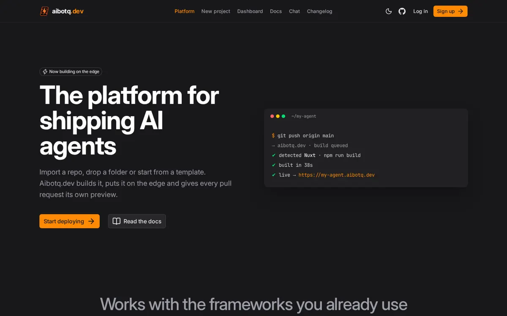

<div align="center">


<h3>aibotq.dev</h3>

[](https://aibotq.dev)
[](https://ui.nuxt.com)

</div>

# aibotq.dev · aibotq-site

The platform for shipping AI agents. Import a GitHub repository, upload a folder or zip, or start from a template, configure the build, and deploy. The site also has a multi-model AI chat with real tools, and an owner mode that lets the site owner read the repo and propose changes from the chat.

แพลตฟอร์มสำหรับ deploy AI agent นำเข้า repo จาก GitHub อัปโหลดโฟลเดอร์/zip หรือเริ่มจากเทมเพลต ตั้งค่า build แล้ว deploy มีแชต AI หลายโมเดลพร้อมเครื่องมือจริง และโหมดเจ้าของที่ให้เจ้าของเว็บอ่าน repo และเสนอการแก้ไขผ่านแชตได้

**Live:** https://aibotq.dev · **Docs:** [/docs](https://aibotq.dev/docs/) · **Changelog:** [/changelog](https://aibotq.dev/changelog/) · **AI agents:** [`/llms.txt`](https://aibotq.dev/llms.txt)



## What's inside / มีอะไรบ้าง

| Feature | Path | What it does |
| --- | --- | --- |
| **Home** | [`/`](https://aibotq.dev/) | Landing page built with Nuxt UI (black/neutral, orange accent, upright fonts). |
| **Import flow** | [`/new`](https://aibotq.dev/new/) | Create a project from a GitHub repo (`import`), a template repo (`template`), a URL (`url`) or a folder/zip (`upload`, needs R2). Framework, build command and output directory are detected. |
| **Dashboard** | [`/dashboard`](https://aibotq.dev/dashboard/) | Your projects and deployments (stored in D1). |
| **Chat** | [`/chat`](https://aibotq.dev/chat/) | Multi-model chat (Anthropic + OpenAI, more via `EXTRA_PROVIDERS` / `EXTRA_MODELS`) with automatic fallback to the other provider and real tool calling. |
| **Owner mode** | `/chat` | Extra repo tools for the site owner. Turns on automatically for logins in `OWNER_GITHUB_LOGINS`, or with the `ADMIN_CHAT_TOKEN` shield button. |
| **GitHub login** | [`/auth/github`](https://aibotq.dev/auth/github) | Sign in with GitHub (nuxt-auth-utils). Users are upserted into D1 and the chat knows who is signed in. |
| **Changelog** | [`/changelog`](https://aibotq.dev/changelog/) | Release notes page, modelled on the Nuxt changelog template. |
| **Docs / Help / Terms / Privacy** | `/docs`, `/help`, `/terms`, `/privacy` | Content pages rendered from `app/content/*.html`. |

### Chat tools / เครื่องมือของแชต

| Tool | Who | What it does |
| --- | --- | --- |
| `current_time` | everyone | Current date and time |
| `web_fetch` | everyone | Fetch a URL the user mentions |
| `read_uploaded_file` | everyone | Read attached files (text, PDF via `unpdf`) |
| `list_projects` / `deploy_status` | everyone | The user's projects and deploys |
| `list_repo_files` / `read_repo_file` | owner | Read the site source repo |
| `propose_change` | owner, needs Confirm | Create a branch and open a PR (never merges to `main`) |
| `trigger_deploy` | owner, needs Confirm | Run `.github/workflows/deploy.yml` |

Write tools never run directly. The server returns an HMAC-signed pending action that the owner must confirm in the UI within 30 minutes. There is no web search tool.

เครื่องมือที่เขียนข้อมูลจะไม่ทำงานทันที ต้องให้เจ้าของกด Confirm ภายใน 30 นาที (ลายเซ็นจากเซิร์ฟเวอร์)

## Quick start / เริ่มต้น

Requirements: Node.js 22+ and npm.

```bash
git clone https://github.com/thanabartbb/aibotq-site.git
cd aibotq-site
npm install                 # also runs `nuxt prepare`
npm run db:migrate:local    # apply migrations to a local D1
npm run dev                 # Nuxt dev server
```

Workers-runtime run (after `npm run build`):

```bash
npm run preview             # wrangler dev
```

## Scripts

| Script | What it does |
| --- | --- |
| `npm run dev` | Nuxt dev server |
| `npm run build` | `nuxt build` → `.output/server/index.mjs` + `.output/public` |
| `npm run preview` | `wrangler dev` on the built output |
| `npm run deploy` | `nuxt build && wrangler deploy` |
| `npm run db:migrate:local` | `wrangler d1 migrations apply aibotq --local` |
| `npm test` | Vitest |

## Architecture

```
Browser (no secrets)                     Cloudflare Worker "aibotq-site" (Nuxt 4 SSR, Nitro cloudflare_module)
──────────────────────────────           ───────────────────────────────────────────────────────────────
/, /new, /dashboard, /docs, /changelog ◄─ SSR pages (app/) + static assets (.output/public)
Sign in with GitHub ───────────────────►  /auth/github (nuxt-auth-utils) ──► GitHub OAuth → D1 users
/new, /dashboard ──────────────────────►  /api/* → server/lib router (projects, repos, uploads, templates)
/chat ─────────────────────────────────►  /api/chat ──► server/utils/llm.ts ──► Anthropic ⇄ OpenAI (+ extra)
                                          /api/chat/admin · /api/chat/confirm (owner, signed actions)
                                          └ D1 "aibotq" · deploy webhook → devstack.bid/api/build
```

- **Stack:** Nuxt 4, Nuxt UI v4, Tailwind CSS v4, TypeScript, nuxt-auth-utils, `unpdf`. Deployed to Cloudflare Workers (Nitro preset `cloudflare_module`, `nodejs_compat`), custom domain `aibotq.dev`.
- **Database:** D1 `aibotq` (binding `DB`), migrations in [`migrations/`](./migrations/). Tables: `users`, `provider_tokens`, `sessions`, `projects`, `deployments`, `rate_limits`, `uploads`.

### Project layout

| Path | Contents |
| --- | --- |
| `app/pages/` | Pages: `index`, `new`, `dashboard`, `chat`, `changelog`, `docs`, `help`, `terms`, `privacy` |
| `app/components/` | `AppHeader`, `AppFooter`, `AppLogo`, `ProseHtml` |
| `app/composables/useAq.ts` | API client and `useSession()` |
| `server/routes/auth/github.get.ts` | GitHub OAuth handler |
| `server/api/` | `chat.post.ts`, `chat/admin.post.ts`, `chat/confirm.post.ts`, `models.get.ts`, `[...path].ts` |
| `server/lib/` | Router, auth, providers, projects, repos |
| `server/utils/` | `llm.ts` (providers/models), `tools.ts` (chat tools), `owner.ts` (owner check) |
| `migrations/` | D1 SQL migrations |
| `public/` | Logo, favicons, `llms.txt`, changelog images |

## Configuration / การตั้งค่า

Names only. Secrets are set with `wrangler secret put` from stdin and are never committed or sent to the browser.

| Name | Kind | Purpose |
| --- | --- | --- |
| `APP_URL` | var | Public origin (`https://aibotq.dev`) |
| `CHAT_MODEL` | var | Default chat model |
| `OWNER_GITHUB_LOGINS` | var | Comma-separated GitHub logins that get owner mode (case-insensitive) |
| `TEMPLATES` | var | Template key → `owner/repo` map |
| `DEPLOY_WEBHOOK_URL` | var | devstack.bid build endpoint |
| `EXTRA_PROVIDERS` / `EXTRA_MODELS` | var | Optional JSON for extra OpenAI-compatible providers/models |
| `ANTHROPIC_API_KEY` / `OPENAI_API_KEY` | secret | Model providers |
| `NUXT_OAUTH_GITHUB_CLIENT_ID` / `NUXT_OAUTH_GITHUB_CLIENT_SECRET` | secret | GitHub OAuth app |
| `NUXT_SESSION_PASSWORD` | secret | Session cookie encryption (32+ chars) |
| `ADMIN_CHAT_TOKEN` | secret | Owner-mode fallback token and action signing key |
| `GITHUB_ADMIN_TOKEN` | secret | Repo access for owner tools |
| `SESSION_SECRET` | secret | Encrypts stored provider tokens |
| `DEPLOY_WEBHOOK_SECRET` / `GITHUB_WEBHOOK_SECRET` | secret | HMAC for deploy and GitHub webhooks |
| `UPLOADS` | R2 binding | Optional: folder/zip uploads (disabled until configured) |

## Deploy

Production runs on the Cloudflare Worker `aibotq-site` with custom domain `aibotq.dev`.

```bash
npm run build
npx wrangler d1 migrations apply aibotq --remote   # only when migrations change
npx wrangler deploy
```

Or run the **deploy** workflow (`.github/workflows/deploy.yml`, manual dispatch). It needs the `CLOUDFLARE_API_TOKEN` Actions secret.

## Contributing / ร่วมพัฒนา

Open an issue or a pull request against `main`. Keep the design black/neutral with orange as a sparing accent, and use upright fonts only.

เปิด issue หรือ pull request มาที่ `main` ได้เลย ดีไซน์ใช้สีดำ/เทา ส้มเป็นสีเน้นเท่านั้น และใช้ฟอนต์ตั้งตรง
